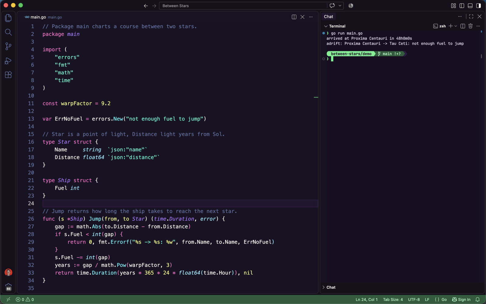

<p align="center"></p>

<h1 align="center">Between Stars</h1>

A dark VS Code theme. The background is purple-black and the accent is green.



## Install

Search for **Between Stars** in the Extensions view, or run:

```sh
code --install-extension cujarrett.between-stars
```

Then pick it with **Preferences: Color Theme**.

For the prompt's icons in the built-in terminal, install the font and set it:

```sh
brew install --cask font-jetbrains-mono-nerd-font
```

```json
"terminal.integrated.fontFamily": "JetBrainsMono Nerd Font"
```

## Credits

Syntax colors come from [Dracula Purple](https://github.com/cbasdev/dracula-purple-theme) by cbasdev (MIT).
